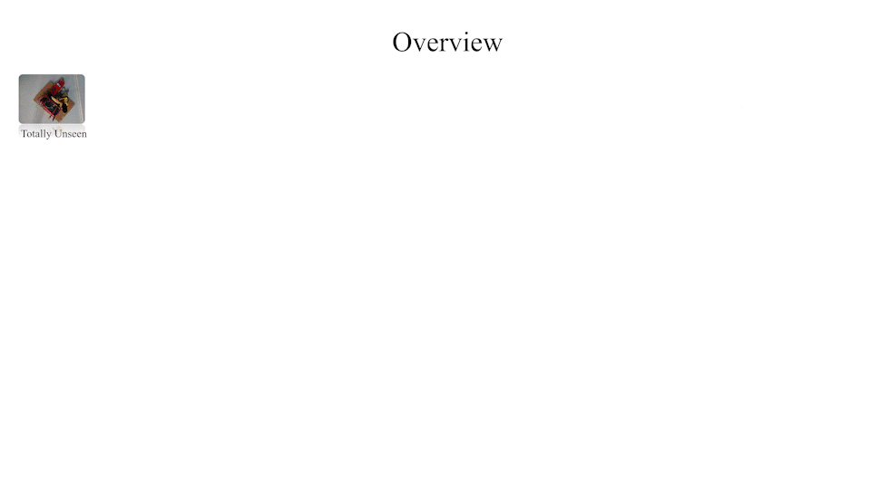

<h1>VGBVS: Distilling Visual Geometry Priors   for Robust Zero-Shot Sim-to-Real Visual Servoing</h1>

## 📖 Overview
Utilizing a lightweight encoder optimized through knowledge distillation and trained entirely on synthetic data, VGBVS enables direct camera-velocity control across diverse unseen scenes using only RGB inputs.

## 📋 Checklist

- [ ] Evaluation code
- [ ] Distilled VGGT aggregator
- [ ] Full model checkpoints